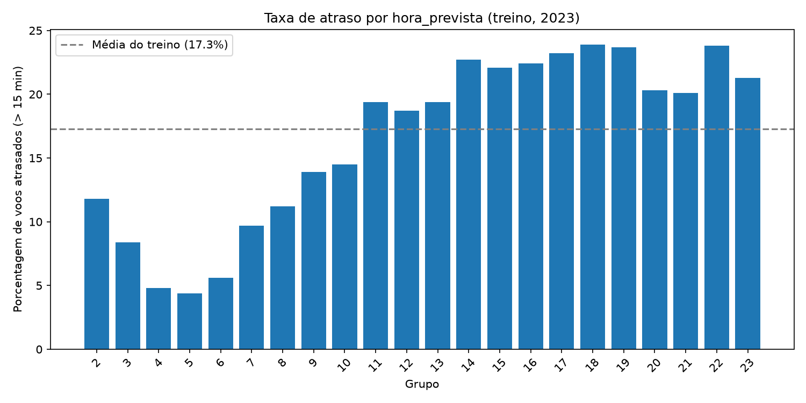
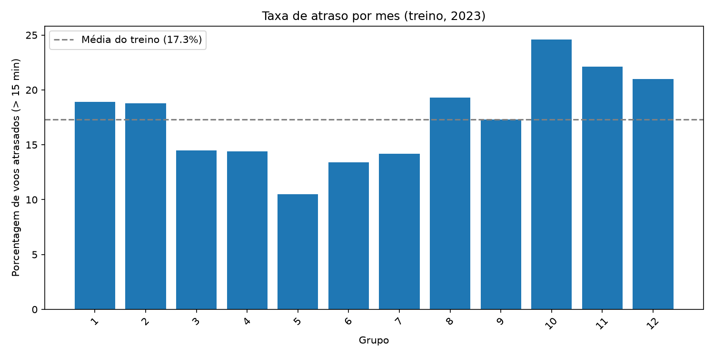

# Previsão de atraso de voos no Brasil

Estimativa da probabilidade de atraso de voos domésticos a partir de dados públicos da ANAC, com avaliação rigorosa do modelo, API REST e, futuramente, um agente que explica o resultado em linguagem simples.

> **Status: em desenvolvimento.** Este README é atualizado a cada etapa.

## Qual decisão este projeto ajuda

Quem vai comprar uma passagem ou escolher o tempo de espera entre dois voos precisa saber qual é o risco de atraso. O projeto estima essa probabilidade usando **apenas informações que existem antes do voo** (rota, companhia, horário, dia da semana e época do ano).

## Dados

- **Fonte:** base VRA (Voo Regular Ativo), da ANAC, com horários previstos e realizados dos voos.
- **Período baixado:** janeiro de 2023 a dezembro de 2025 (36 arquivos mensais em CSV), obtido em 22 de novembro de 2026.
- **Divisão por data:**
  - Treino: 2023
  - Validação (ajuste do modelo): 2024
  - Teste final: 2025
- **Tamanho:** cerca de 421 MB no total, com 2.972.195 registros brutos e 2.273.140 voos domésticos realizados após a limpeza.
- **Exclusão:** 2020 a 2022, por causa dos efeitos da pandemia e da retomada do setor aéreo. *(Hipótese a confirmar nos dados.)*
- **Seleção de aeroportos e rotas** (regra definida antes de modelar, usando só o treino de 2023):
  1. Os **16 aeroportos** com mais saídas no treino. O corte fica logo antes de uma queda de volume na lista (de cerca de 12,8 mil para cerca de 11 mil saídas).
  2. Rotas (origem-destino) entre esses aeroportos com pelo menos **500 voos no treino**: **148 rotas**.
  3. A mesma lista de rotas vale para validação e teste. Voos de rotas que não estão na lista saem desses conjuntos.

  Aeroportos selecionados (código ICAO): SBSP, SBGR, SBRJ, SBKP, SBBR, SBCF, SBRF, SBPA, SBSV, SBCT, SBFZ, SBGL, SBBE, SBFL, SBGO, SBVT.

  | Conjunto | Voos nas rotas selecionadas | Voos realizados do ano | Parte mantida |
  |---|---|---|---|
  | Treino (2023) | 413.252 | 752.437 | 54,9% |
  | Validação (2024) | 373.367 | 750.585 | 49,7% |
  | Teste (2025) | 403.594 | 770.118 | 52,4% |
  | **Total** | **1.190.213** | **2.273.140** | **52,4%** |

  O modelo só opina sobre essas 148 rotas. Voos fora delas não são avaliados, e essa é uma limitação do projeto.

### Dicionário de dados

Colunas da base VRA utilizadas no projeto:

| Coluna | Significado | Tipo | Fuso/formato | Uso no projeto |
|---|---|---|---|---|
| ICAO Empresa Aérea | Sigla ICAO (International Civil Aviation Organization) para empresas aéreas | Texto | - | Variável |
| Número Voo | Numeração do voo | Texto | - | Identificador |
| Código Autorização (DI) | Caractere usado para identificar o Dígito Identificador (DI) para cada etapa de voo | Texto | - | Filtro |
| Código Tipo Linha | Caractere usado para identificar o Tipo de Linha realizada para cada etapa de voo | Texto | - | Filtro |
| ICAO Aeródromo Origem | Sigla ICAO do aeroporto de origem | Texto | - | Variável |
| ICAO Aeródromo Destino | Sigla ICAO do aeroporto de destino | Texto | - | Variável |
| Partida Prevista | Data e horário da partida prevista informada pela empresa aérea | Data | Brasília | Variável |
| Partida Real | Data e horário da partida realizada informada pela empresa aérea | Data | Brasília | Auxiliar (calcula o alvo) |
| Chegada Prevista | Data e horário da chegada prevista informada pela empresa aérea | Data | Brasília | Descartada na v1 |
| Chegada Real | Data e horário da chegada realizada informada pela empresa aérea | Data | Brasília | Descartada na v1 |
| Situação Voo | Campo informando a situação do voo: realizado, cancelado ou não informado | Texto | - | Filtro |
| Código Justificativa | Este campo deixou de ser exigido a partir de abril de 2020, com a revogação da Instrução de Aviação Civil (IAC) 1504 | Texto | - | Descartada |

#### Regras adotadas

- **Fuso Horário:** todos os horários da base estão no horário de Brasília [fonte: metadados do VRA da ANAC - https://www.gov.br/anac/pt-br/acesso-a-informacao/dados-abertos/areas-de-atuacao/voos-e-operacoes-aereas/voo-regular-ativo-vra/62-voo-regular-ativo-vra]. Nenhuma conversão foi necessária.
- **Definição de atraso:** a ANAC não fixa oficialmente um tempo de diferença entre horário de partida prevista e horário de partida real como atraso. Contudo, o limite usado por referências internacionais (DOT, EUROCONTROL) é de 15 minutos. A Seção § 234.2 (Definitions) do Title 14 CFR Part 234 (Departamento de Transportes dos EUA — DOT) define textualmente o termo Late or late flight (voo atrasado) como qualquer voo que chegue ao portão 15 minutos ou mais após o horário de chegada publicado. O indicador OTP15 da EUROCONTROL / Cirium / OAG classifica como pontual o voo que chega ou parte em até 15 minutos após o horário programado (sendo considerado atrasado a partir de 15 minutos e 1 segundo). Portanto, adaptando-se as referências para partida, alvo `atrasado` vale 1 quando o tempo de diferença entre horário de partida prevista e horário de partida real é maior que 15 minutos e 0 caso contrário.
- **Voos cancelados:** excluídos e tratados a parte, visto que o alvo não existe para eles, não possuem partida real, portanto o atraso não pode ser medido.
- **Voos sem horário previsto:** excluídos, porque sem ele não é possível medir atraso.
- **Número do voo:** tratado como texto, pois há valores com letras. Não é usado como variável na primeira versão.
- **Duplicados:** removidos pela combinação companhia, número do voo, origem e partida prevista.
- **Formato do arquivo:** a primeira linha contém a data de atualização e é ignorada na leitura. Separador `;`, valores ausentes como `null`.

#### Códigos usados

- **Código Tipo Linha:** 'N' = Doméstica Mista.
- **Código Autorização (DI):** '0' = Etapa Regular, '2' = Etapa Extra, '4' = Inclusão de Etapa.

## Limpeza dos dados

Executada por `python -m src.prepare_data`. Cada regra remove linhas, e o script registra a contagem depois de cada passo:

| Passo | Regra | Linhas restantes | Removidas |
|---|---|---|---|
| 0 | Registros brutos (36 arquivos) | 2.972.195 | – |
| 1 | Tipo de linha `N` (doméstica) | 2.401.163 | 571.032 |
| 2 | Considera Etapa Regular (DI = 0), Etapa Extra (DI = 2) e Inclusão de Etapa (DI = 4) | 2.357.369 | 43.794 |
| 3 | Mantém só voos com partida prevista | 2.335.182 | 22.187 |
| 4 | Remove duplicados (empresa, voo, origem, partida prevista) | 2.335.165 | 17 |
| 5 | Separa cancelados (62.024) e realizados | 2.273.141 | - |
| 6 | Partida prevista entre 2023 e 2025 | 2.273.140 | 1 |
| 7 | Mantém as 148 rotas selecionadas | 1.190.213 | 1.082.927 |

Divisão final:

| Grupo | Linhas |
|---|---|
| Voos realizados (com alvo) | 2.273.140 |
| Voos cancelados (fora do alvo) | 62.024 (2,66%) |


## Taxa de atraso por conjunto

Considerando atraso como partida real mais de 15 minutos depois da prevista:

| Conjunto | Ano | Voos | % atrasados |
|---|---|---|---|
| Treino | 2023 | 752.437 | 16,3% |
| Validação | 2024 | 750.585 | 15,7% |
| Teste | 2025 | 770.118 | 14,9% |

Reprodução: `python analysis/taxa_por_conjunto.py`.

Um modelo que sempre responde "não atrasa" acertaria 84,3% dos voos no conjunto de validação. Por isso, a acurácia sozinha não é usada como métrica.

## Exploração

Análise feita **somente com o treino (2023)**, restrito às 148 rotas selecionadas (413.252 voos, taxa média de atraso de **17,3%**). Esta média é maior que a de todo o treino (16,3%) porque as rotas selecionadas concentram os aeroportos mais movimentados. Script: `analysis/explorar.py`. Gráficos em `docs/figuras/`.

### Principais achados

1. **A hora de partida é a variável mais informativa.** A taxa de atraso cresce ao longo do dia, sendo 4,4% às 5h e 4,8% às 4h, contra 23,9% às 18h e 23,7% às 19h. Voos entre 17h e 23h ficam acima de 20%.
2. **Há sazonalidade e efeito do dia da semana.**
   - Por mês: o menor valor é maio (10,5%) e o maior é outubro (24,6%), seguido de novembro (22,1%) e dezembro (21,0%).
   - Por dia da semana: quinta (20,5%) e sexta (20,9%) têm mais atrasos, e sábado (12,7%) tem menos.
3. **Aeroporto e companhia também diferem.**
   - Entre os aeroportos de origem, Guarulhos (SBGR, 22,1%) e Congonhas (SBSP, 20,0%) ficam acima da média, e Brasília (SBBR, 8%) fica bem abaixo.
   - Entre as companhias, GLO tem 20,3%, TAM 17,2% e AZU 14,4%.





### Como ler estes resultados

- Cada gráfico mostra uma variável **isolada**. Hora, aeroporto, companhia e dia da semana estão relacionados entre si (por exemplo, o perfil de voos por hora muda de um aeroporto para outro), então não dá para dizer quanto cada uma pesa. É o modelo que separa essas contribuições.
- Diferenças entre grupos **não provam causa**. O aumento do atraso ao longo do dia é compatível com o acúmulo de atrasos (um voo atrasado de manhã atrasa os seguintes), mas isso não foi testado aqui.
- Os grupos das 2h e 3h têm poucos voos (3.289 e 3.913) e taxas menos confiáveis. Os demais têm volume mais sólido, e todos os aeroportos e companhias do gráfico têm mais de 6 mil voos.
- O padrão mensal vem de **um único ano** (2023). A validação (2024) e o teste (2025) mostram se ele se repete.

## Principais decisões de modelagem

- **Divisão por data, e não aleatória:** o modelo treina com o passado e é testado com o futuro, como seria na prática.
- **Sem vazamento de dados:** nenhuma informação obtida depois do voo entra como variável.
- **Comparação com uma linha de base** (taxa histórica de atraso por hora): um modelo só vale se superá-la.
- **Calibração das probabilidades:** quando o modelo diz 30%, cerca de 30% dos voos devem atrasar.

## Resultados

*Em construção.*

| Modelo | ROC-AUC | Brier score |
|---|---|---|
| Linha de base: taxa global | 0,500 | 0,13787 |
| Linha de base: taxa por rota | 0,544 | 0,13788 |
| Linha de base: taxa por hora | 0,616 | 0,13460 |
| Regressão logística | – | – |
| Gradient boosting | – | – |

Os modelos são treinados em 2023 e avaliados em 2024 nas 148 rotas selecionadas.

## Tecnologias

- Em uso: Python · DuckDB · pytest · pandas · matplotlib · pyarrow
- Planejadas: FastAPI · PostgreSQL · GitHub Actions · scikit-learn

## Roadmap

- [x] Download automatizado dos dados (com validação e testes)
- [x] Limpeza dos dados e criação do alvo
- [x] Análise exploratória e linha de base
- [ ] Modelagem e avaliação
- [ ] Banco de dados PostgreSQL
- [ ] API REST (FastAPI)
- [ ] Testes automatizados e CI
- [ ] Agente conversacional (opcional)

## Como rodar

Requisitos: Python 3.12 ou superior e Git. Desenvolvido e testado no Windows com Python 3.14.

### 0. Preparar o ambiente

```bash
git clone https://github.com/RPMFerreira/previsao-atraso-voos.git
cd previsao-atraso-voos
python -m venv .venv
```

Ativar o ambiente virtual:

```bash
# Windows (PowerShell)
.venv\Scripts\activate
# Linux/macOS
source .venv/bin/activate
```

Instalar as dependências:

```bash
pip install -r requirements.txt
```

> No PowerShell, se a ativação for bloqueada, execute uma vez `Set-ExecutionPolicy -Scope CurrentUser RemoteSigned`.

Todos os comandos abaixo devem ser executados **na raiz do projeto**, com o ambiente ativado.

### 1. Baixar os dados

```bash
python -m src.download_data
```

Baixa os 36 arquivos mensais (janeiro de 2023 a dezembro de 2025) da ANAC para `data/raw/`, cerca de 420 MB no total. A pasta `data/` é ignorada pelo Git. O script pula arquivos que já existem e valida cada download, então pode ser executado de novo sem repetir o trabalho. Para mudar o período, edite a chamada de `baixar_intervalo` no final do arquivo `src/download_data.py`.

### 2. Limpar os dados e criar o alvo

```bash
python -m src.prepare_data
```

Lê os CSVs, aplica as regras descritas em "Limpeza dos dados", seleciona os 16 aeroportos e as 148 rotas e grava em `data/processed/`:

| Arquivo | Conteúdo |
|---|---|
| `voos.parquet` | Todos os voos domésticos realizados, com o alvo `atrasado` e o conjunto (treino, validação ou teste) |
| `voos_selecionados.parquet` | Os voos das 148 rotas selecionadas (base da modelagem) |
| `cancelados.parquet` | Voos cancelados, fora do alvo |

A execução mostra no terminal a contagem de linhas depois de cada regra. O primeiro número deve ser 2.972.195.

### 3. Análises

```bash
python analysis/taxa_por_conjunto.py   # taxa de atraso por conjunto
python analysis/explorar.py            # tabelas e gráficos (salvos em docs/figuras/)
python analysis/linha_de_base.py       # linha de base: ROC-AUC e Brier Score
```

### 4. Testes

```bash
pytest
```

### Estrutura do repositório

```
src/                 download e preparação dos dados
analysis/            exploração e linha de base
tests/               testes automatizados (pytest)
docs/figuras/        gráficos usados neste README
data/                dados (não versionados)
```

## Limitações

### Escopo
- **O modelo cobre só 148 rotas entre 16 aeroportos** (cerca de 52% dos voos domésticos regulares de 2023 a 2025). Voos de outras rotas não são avaliados, e o sistema não deve ser usado para elas.
- **Estima atraso, e não cancelamento.** Os 62.024 voos cancelados (2,66% do total) ficam fora do alvo. Quem escolhe uma passagem também se importa com cancelamento, e isso não está coberto.
- **Voos internacionais e de outros tipos de linha foram excluídos** (só o tipo `N`, doméstica).

### Definição do alvo
- **O limite de 15 minutos é uma escolha.** A ANAC não fixa um limite oficial e adaptei referências internacionais que medem a chegada para a **partida**. Outro limite (por exemplo 30 minutos) daria outros resultados.
- **O atraso é medido na partida.** Para quem viaja, o atraso na chegada também importa, e não foi modelado.

### Dados
- **Voos com código de autorização (DI) fora de 0, 2 e 4 foram excluídos**.
- **O volume de 2024 nas rotas selecionadas é menor** (373.367 voos, contra 413.252 em 2023 e 403.594 em 2025), embora o volume total do ano seja parecido. A causa não foi investigada.
- **`voos_na_hora` conta apenas voos domésticos regulares** que permaneceram na base. Não inclui voos internacionais nem de outros tipos, então não representa o movimento total do aeroporto.
- **Os horários vêm informados pelas empresas aéreas** e não foram verificados de forma independente.
- **A base não traz o motivo dos atrasos.** O campo de justificativa deixou de ser exigido em 2020, então causas como clima ou manutenção não são conhecidas.

### Modelagem e avaliação
- **A taxa de atraso diminui de um ano para o outro** (16,3% em 2023, 15,7% em 2024 e 14,9% em 2025, em todos os voos do treino, da validação e do teste). Um modelo treinado em 2023 tende a superestimar o atraso depois, o que prejudica o Brier Score e a calibração.
- **O padrão mensal vem de um único ano de treino.** Se a sazonalidade mudar, o modelo não acompanha.
- **O atraso de um voo individual tem muito de aleatório.** Por isso, espera-se que os ganhos de Brier Score sejam pequenos em qualquer modelo, e o AUC é o melhor indicador do que foi aprendido.
- **Não entram variáveis de clima, feriados, congestionamento em tempo real nem a cadeia de voos** (um atraso anterior da mesma aeronave), que provavelmente explicam boa parte dos atrasos.

## Aviso

As previsões são **estimativas estatísticas** baseadas em dados históricos. Não são garantia nem aconselhamento sobre compra de passagens.

## Autor

Rafael Pires de Melo Ferreira · [LinkedIn](https://www.linkedin.com/in/rafaelpmferreira/)
